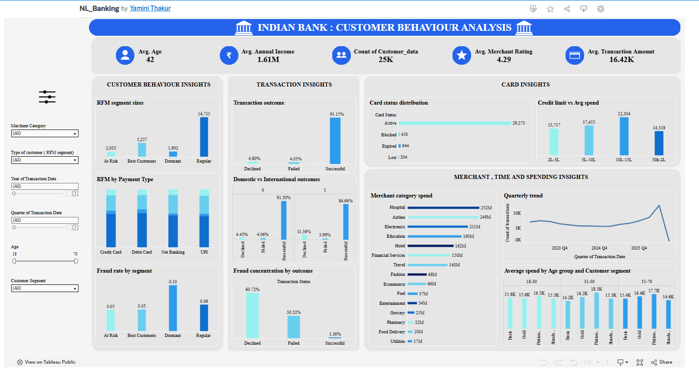

# Indian Bank – Customer Behaviour Analysis

An Exploratory Data Analysis (EDA) project that studies how bank customers use cards, make transactions, and shop with merchants.

## Dashboard

[View the Tableau dashboard](https://public.tableau.com/views/Bank_17880914918440/Dashboard1?:language=en-US&:sid=&:redirect=auth&:display_count=n&:origin=viz_share_link)

## Goal

Find out which customer, card, transaction, and merchant features really change customer behaviour and business results. This helps the bank improve engagement, card usage, and customer experience.

## Data

Four linked tables:

| Table | Size |
|---|---|
| Customer_data | 25,000 customers |
| Card_Data | 32,457 cards |
| Transaction_Data | 100,000 transactions |
| Merchant_table | Merchant profiles |

- All Customer_ID, Card_ID, and Merchant_ID values match their master tables (no orphan records).
- Dates were cleaned into one format.
- No duplicate Transaction_IDs or major null values.

## Key Metrics

- Transaction Amount (total and average spend)
- Transaction Status (success, decline, failure)
- Fraud Flag (fraud rate)
- RFM Segment (Recency, Frequency, Monetary)

## Method

- **RFM segmentation:** Each customer is scored 1–5 on Recency, Frequency, and Monetary value (by quintile). Scores 4–5 = high, 1–2 = low. Customers are grouped into **Best Customers, Regular, At Risk, Dormant**.
- **Recency** is measured from the latest date in the data, not today's date.
- **Rates, not counts:** Fraud and outcome results use transaction rates (fraud transactions ÷ total transactions). This avoids bias, because Best Customers transact more and would otherwise look worse.

## Hypotheses and Results

| # | Hypothesis | Result |
|---|---|---|
| H1 | Demographics affect behaviour/RFM segment | Rejected |
| H2 | Digital payments (UPI, Net Banking, mobile) mean higher engagement | Confirmed |
| H3 | International transactions succeed less than domestic | Confirmed |
| H4 | Dormant customers have worse outcomes | Confirmed |
| H5 | Card type, network, mode affect success rate | Rejected |
| H6 | Higher credit limit means higher average spend | Confirmed |
| H7 | Merchant risk level predicts fraud | Rejected |
| H8 | Fraud is more linked to failed/declined transactions | Confirmed |

## Key Findings

- **Segments:** Regular 61.6%, Best 22.0%, At Risk 8.5%, Dormant 8.0%. Age, gender, income, occupation, and state do not change this split.
- **Dormant customers:** Fraud rate 9.9% (others 4.6–5.8%). Decline rate 10.9% (others 3.5–5.3%). Success rate 86.4% (others 90.7–92.1%).
- **Card health:** 1,994 of 32,457 cards (6.1%) are Blocked, Expired, or Lost. Many Dormant customers may just need a new card.
- **Overall success rate:** About 91%.
- **No effect on success rate:** Channel, device, payment method, card type, network, and card mode (all about 89–92%).
- **International vs domestic:** 84.6% vs 91.5% success.
- **Fraud detection works:** About 60% of Declined and 30% of Failed transactions are fraud-flagged, vs only 1–2% of Successful ones.
- **Merchant risk level:** High, Medium, and Low risk merchants show almost the same fraud pattern.
- **Credit limit:** Average spend rises from ₹14,318 (₹50k–2L limit) to ₹22,304 (₹10L–15L limit), a 56% increase.
- **Merchant categories:** Hospital, Airline, and Electronics bring the most spend because each transaction is large. Hotel has the most transactions (8,270). Electronics (₹37,333) and Hospital (₹35,469) have the highest average value. Food Delivery (₹2,986) and Utilities (₹3,385) have the lowest.
- **Time patterns:** Volume dipped in 2024, recovered in 2025, and spiked in 2026 Q2. Late-night (12AM–6AM) transactions have a slightly higher failure rate (about 10% vs 8.5% in the afternoon).
- **Tier vs age:** Customer tier matters more than age. Platinum averages ₹17,980 per transaction vs ₹15,047 for Standard. 31–50 Platinum customers spend the most per customer (₹76,772).

## Recommendations

1. Run a card renewal/reissue campaign for Dormant customers.
2. Promote digital payments (UPI, Net Banking), especially to Regular and At Risk customers.
3. Review international transaction rules to reduce wrongful declines.
4. Raise credit limits for high-spend, low-risk customers.
5. Recalibrate the merchant risk classification.
6. Look into late-night and POS channel friction.

## Limitations

- Dormant is a small group (about 3% of transactions), so its rates are less stable.
- Some groups are tiny (e.g. 31–50 Basic: 14 customers, 56 transactions). Treat as directional only.
- 2026 Q3 is a partial quarter. Do not read it as a decline.
- Results show patterns, not cause and effect. Test before acting.
- RFM thresholds are one of several valid choices; results may shift slightly with others.
